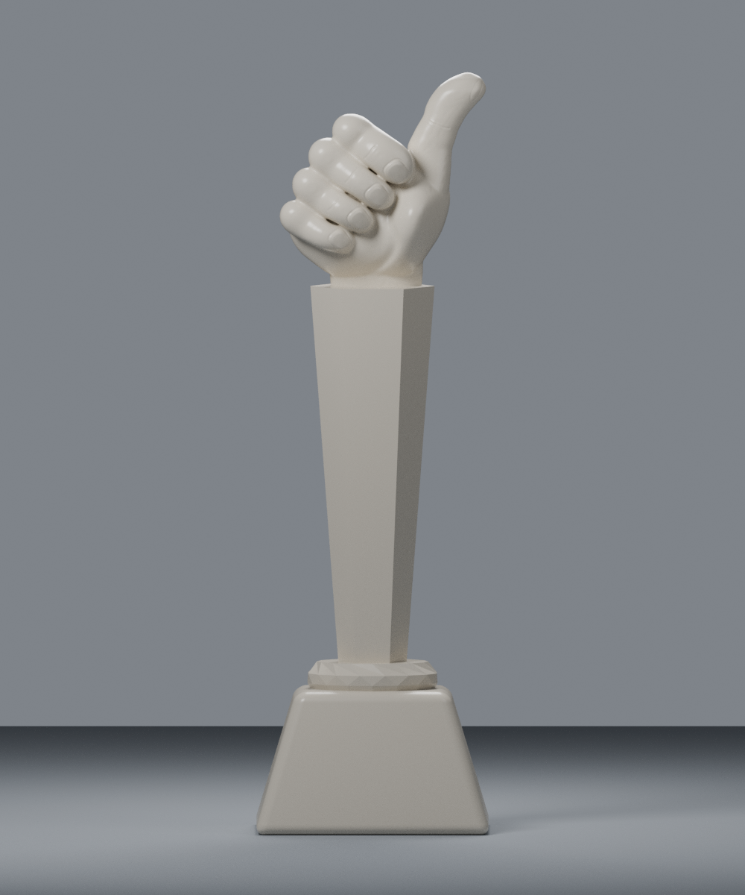
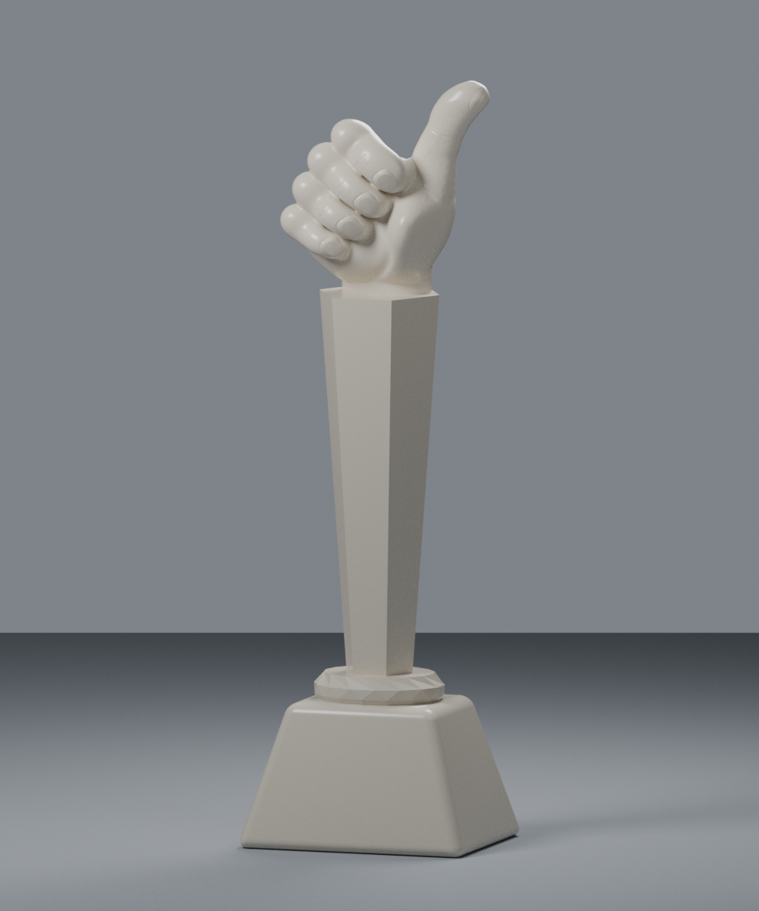
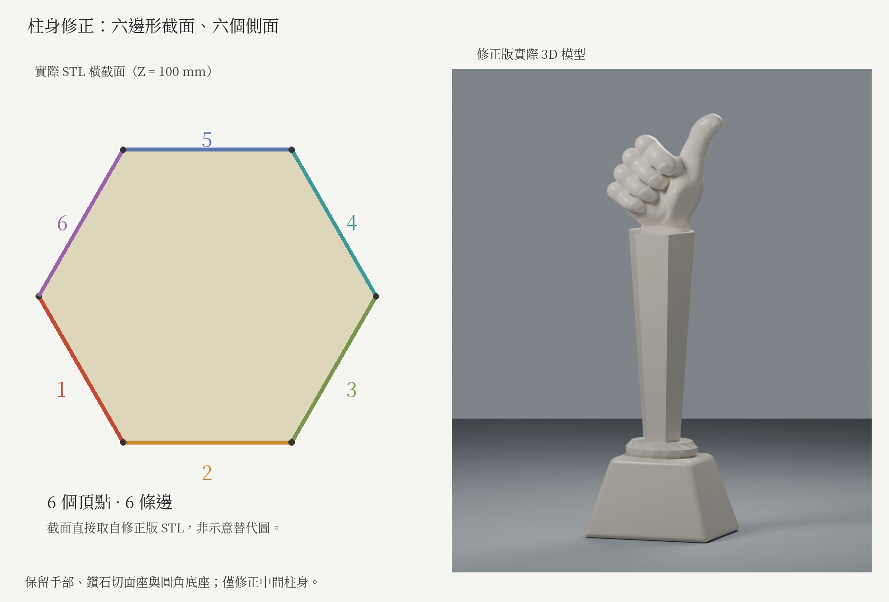

# 讚手造型獎座｜Thumbs-up Trophy

200 mm 高、可編輯的 3D 列印獎座。造型包含實心讚手、正六邊形漸收柱身、鑽石切面座與圓角斜面底座，文字及標誌留白。

## 模型預覽

### 正面


### 透視


### 六邊形柱身截面


以上為實際 3D 模型渲染及網格截面。手部細節是雕塑重建，並非實體掃描。

## 檔案

- `thumbs_up_trophy_200mm.stl`：列印網格，單位 mm。
- `thumbs_up_trophy_editable.blend`：Blender 原始檔，含完成模型、隱藏建構部件、相機及燈光。
- `create_trophy.py`：程序化建模原始碼。
- `close_hand_volume.py`：手部實體封閉處理程式。
- `sculpt_displacements.npz`：數值雕塑位移資料，重建時需要；不含參考圖片。
- `requirements.txt`：外部 Python 套件版本。
- `validate_stl.py`、`validation.json`：獨立 STL 檢查程式與結果。
- `column_section_validation.json`：不同高度的柱身截面座標。
- `trophy_*.png`、`hand_*_detail.png`、`hexagonal_column_review.png`：實際模型預覽。

## 尺寸與幾何檢查

外接尺寸約 **61.276 × 49.338 × 200 mm**，底面位於 Z=0。

- 單一水密、封閉、法向一致的網格，體積為正。
- 四根彎曲手指與豎起的拇指連為實體，沒有封閉內殼或貫穿孔洞。
- 柱身為正六邊形截面，具有六個平面側面。
- 非流形／邊界邊、非流形頂點鄰接環、退化三角形均為 0。
- Euler 特徵值為 2；詳細數值與 STL SHA-256 見 `validation.json`。

## 列印前

以平底朝下、直立放置，匯入 STL 時選擇 mm。手指下緣等懸空位置需要依機器、材料及切片設定配置支撐，請逐層檢查手部、手腕與柱身交界。

「封閉實體」描述幾何沒有內部空腔，**不代表切片器已設定 100% 填充**。希望手部滿料，可另於手部高度設定 100% 填充。縮小模型時，請重新檢查指甲、細紋與外牆是否能可靠列印。

本模型尚未實體試印，未提供 G-code，也不宣稱免支撐。網格拓撲檢查不等於切片模擬、自交完整認證或實體列印保證。

## 編輯與重建

使用 **Blender 4.3.2** 開啟 `.blend`。完成模型物件為 `Trophy PRINT - one closed solid`；`EDITABLE CONSTRUCTION (hidden)` 集合保留可編輯建構部件。地面、相機及燈光僅供預覽，不應一起匯出列印。

重建需要 Blender 4.3.2，以及外部 Python 3 環境：

```sh
python3 -m pip install -r requirements.txt
blender -b -P create_trophy.py
python3 validate_stl.py
```

將原始碼與 `sculpt_displacements.npz` 放在同一資料夾。程式以自身所在資料夾解析資源及輸出，不需要參考圖片。重建會清空 Blender 目前場景並覆寫同資料夾的輸出，請先備份，並使用新的場景或背景模式。

可用環境變數 `TROPHY_PYTHON` 指定外部 Python 執行檔，`TROPHY_PYTHONPATH` 指定套件路徑。`TROPHY_SAMPLES` 控制預覽採樣數；`TROPHY_SKIP_HAND_PREVIEWS=1` 可略過手部特寫渲染。修改 `HEIGHT_MM` 可縮放最終模型；驗證程式預設檢查 200 mm 版本。

數值雕塑位移資料對應固定建構拓撲；修改早期手部建構或使用不同版本軟體可能改變頂點排序。程式會檢查頂點數，不應將位移資料直接套用到任意網格。
